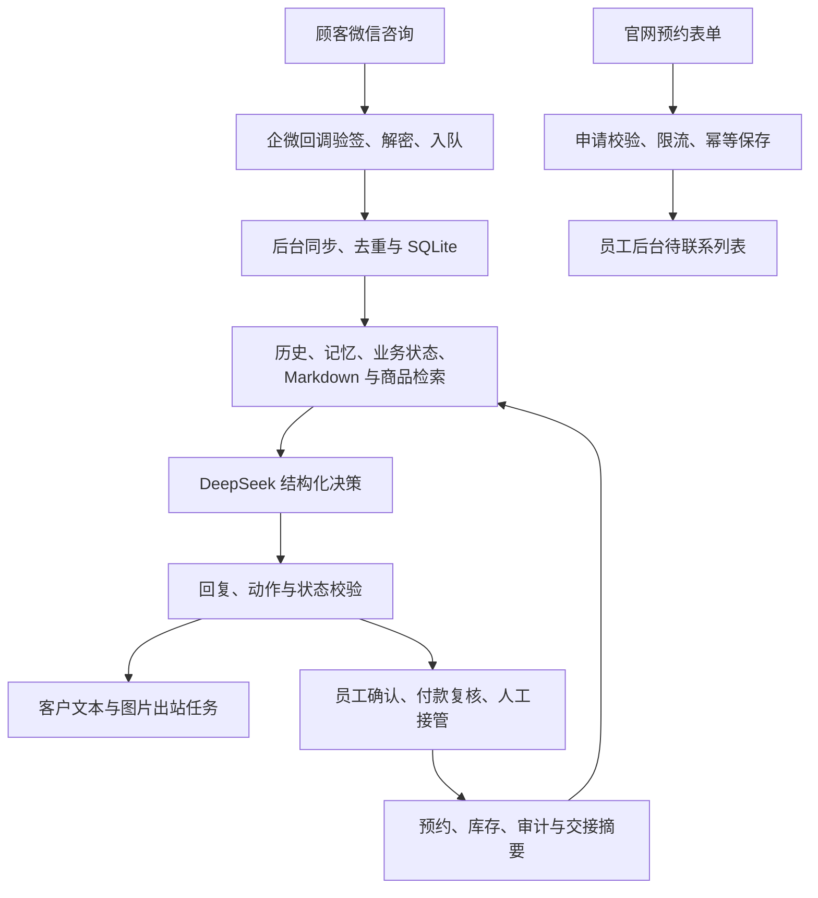
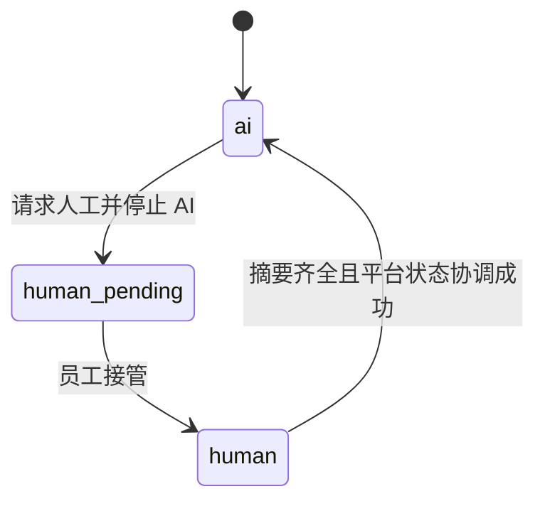

# 技术架构

本目录包含 Forthatday 原版业务源码，覆盖对话、业务动作、员工后台、库存和官网预约申请。运行密钥、数据库和私有媒体不随代码发布。

## 系统链路

官网申请仅表示待跟进意向，不自动走完整的已确认试纱预约流程。

## 代码分层

| 层 | 责任 | 入口 |
| --- | --- | --- |
| Domain | 会话所有权、预约状态、消息、付款证据、记忆和动作契约 | [领域目录](../src/forthatday_agent/domain/) |
| Application | 模型编排、回复与动作策略、任务执行、员工操作与管理界面 | [应用目录](../src/forthatday_agent/application/) |
| Infrastructure | 模型、平台、SQLite、OCR、知识与目录适配 | [基础设施目录](../src/forthatday_agent/infrastructure/) |

## 关键设计

- 回调请求不等待模型或 OCR，持久化后快速返回，后台完成慢操作。
- 模型只输出结构化建议；动作执行器检查业务状态与权限，不能靠提示词代替审批。
- 入站按消息 ID 去重，出站与动作有幂等标识、有限重试、失败状态和任务恢复。
- SQLite WAL 适合当前小型门店单机规模，但没有据此宣称可支持高并发多实例。
- Markdown 按标题分块，标题词项权重高于正文；商品按文字和可解释标签匹配，而非向量相似度。
- 人工接管先阻止 AI，再协调企微状态；回复生成和发送阶段都检查会话所有权。

## 所有权

领域方法只改变领域状态，实际平台核验由应用服务和企微适配器完成。仅将本地 `owner` 改成 `ai` 并不能证明企微已经允许发送。

## 部署边界

Docker Compose 和 Caddy 用于容器化运行与 HTTPS；数据库、私有商品目录、客户媒体和付款规则在运行环境独立持久化。仓库里的历史部署脚本不能直接替代现网的受控备份、路由核验与回滚流程。
