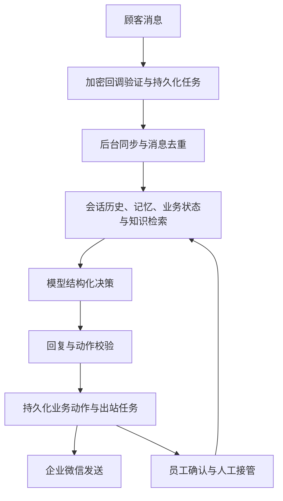
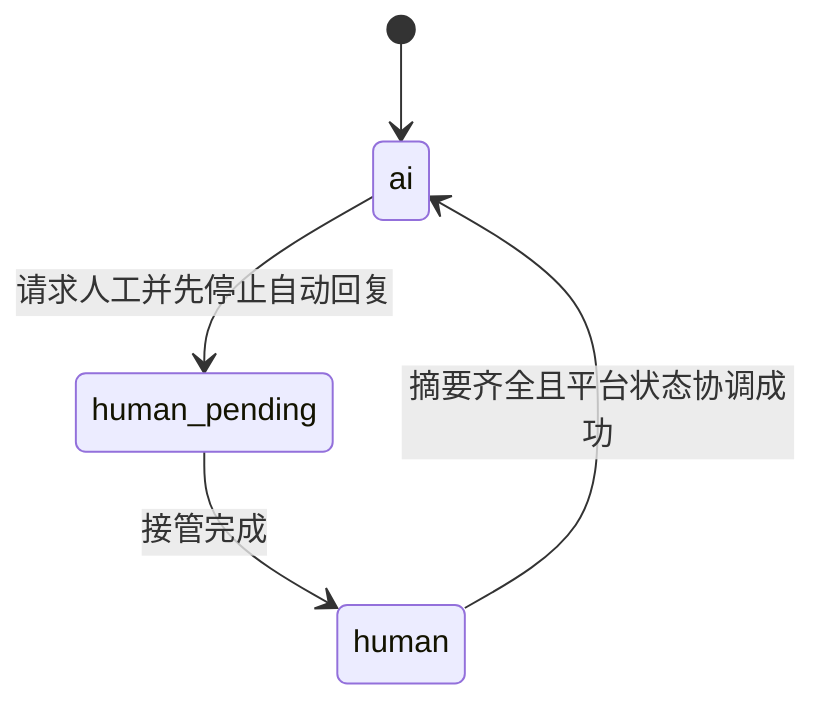

# 技术架构与设计取舍

_客服 Agent 项目技术说明；完整系统架构与公开代码范围分别标注。_

## 完整系统消息链路

模型、完整提示词、员工界面及部分动作执行代码未在公开节选中提供，不能把架构图理解为本仓库可直接启动的完整应用。

## 分层与适配器

- `domain` 定义会话所有权、预约、付款证据和模型决策数据，不依赖企业微信 HTTP 接口。
- `application` 编排消息处理、同步和员工确认，通过协议依赖存储与发送端。
- `infrastructure` 实现 SQLite、Markdown 检索、模型接口和企业微信访问。

渠道变化时复用领域与编排层，替换渠道适配器；迁移仍需重新核对认证、消息能力、平台状态和限制，不能仅换一个 URL。

## 关键取舍

| 选择 | 原因 | 代价与边界 |
| --- | --- | --- |
| 小规模场景使用 SQLite WAL | 降低单机部署与维护成本，持久化任务可恢复 | 不能据此宣称支持大量并发；多实例需额外设计 |
| 回调仅验证与入队 | 将慢模型、OCR、媒体下载移出请求路径 | 需要后台任务、监控和失败恢复 |
| 模型输出结构化 JSON | 将理解与建议同执行分离 | 解析成功不代表业务正确，仍需动作校验 |
| Markdown 词项检索 | 小知识库可解释、便于编辑和追踪来源 | 同义表达和语义召回有限；没有向量索引 |
| 显式人工所有权 | 明确谁能回复，避免人工与 AI 冲突 | 还需协调平台状态，单改本地字段不够 |

## 所有权转换

领域模型的 `activate_ai` 是最后一步，不代表它自身执行了平台核验。真实交接由应用服务和平台适配器配合完成；演示只展示领域状态转换，平台分支由伪造传输层测试覆盖。

## 消息可靠性边界

消息去重、任务状态和业务幂等降低重复副作用；生成和发送阶段均检查会话所有权。该机制并非覆盖任意时序的形式化互斥保证，仍需关注在途请求和事务边界。

当外部接口已处理而本地未收到结果时，单纯重试无法证明端到端 exactly-once，需要平台幂等能力或额外对账。失败日志也应避免包含凭证和完整客户消息。
